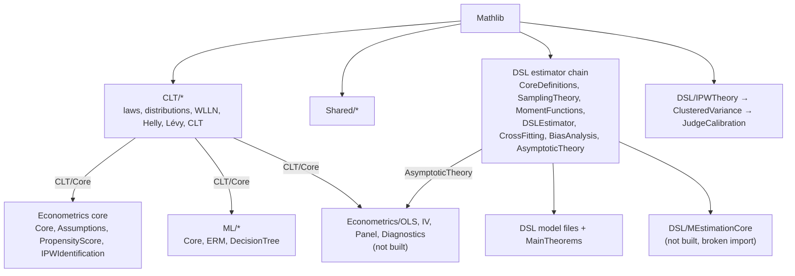

# FormalProbability (Lean 4)

Lean 4 / Mathlib formalizations of probability, causal inference, and the statistics of
using machine-learning (including LLM) annotations in downstream estimation. The most
complete part is a proof of the classical i.i.d. central limit theorem via characteristic
functions, Helly selection, and Lévy continuity. Next to it are a measure-theoretic proof
that inverse probability weighting (IPW) identifies the average treatment effect, and a
formalization of **design-based supervised learning** (DSL; Egami, Hinck, Stewart & Wei).
DSL is a framework for using predicted labels in regressions without bias from prediction
error. The DSL part also covers the Horvitz-Thompson/Hájek, clustered-variance, and
judge-calibration estimators used when an LLM judge stands in for a human oracle. The goal
is to state these estimators precisely and machine-check what can be proved about them. The
tables below say which parts are proved and which are still placeholders or rest on
assumptions.

Author: [Mitchell Linegar](https://mlinegar.github.io)

## Status at a glance

- **Toolchain:** `leanprover/lean4:v4.27.0-rc1`, Mathlib `v4.27.0-rc1` (pinned to commit
  `32d24245` in `lake-manifest.json`).
- **No `sorry`, `admit`, or `axiom` declarations** in any file. The word `sorry` appears
  once, inside a doc comment in `FormalProbability.lean`.
- **346 `theorem`/`lemma` declarations** across 66 `.lean` files. Ten of those files are
  `README.lean` modules that contain only documentation.
- **What `lake build` checks:** the default target is the root module
  `FormalProbability.lean`. It reaches 42 modules, which hold 221 of the 346 theorems. Another
  14 modules (125 theorems) are not imported by the root, so `lake build` never checks them:
  `Econometrics/{OLS,IV,Panel,Diagnostics}/*` and `DSL/MEstimationCore`.
  `DSL/MEstimationCore` imports a module that does not exist
  (`FormalProbability.Probability.Core`), so it cannot compile as written.
- **"No `sorry`" does not mean "fully formalized."**
  - 78 theorems are placeholders. 74 of them are in the unbuilt Econometrics submodules.
  - 21 DSL theorems (plus 9 in the unbuilt `AsymptoticOLS`) are conditional on assumption
    bundles whose fields state the conclusion. See
    [Caveats on the asymptotic results](#caveats-on-the-asymptotic-results).
- **How these numbers were obtained:** by reading the source, not by building it. There is no
  CI. The method and the full list of placeholder theorems are in
  [docs/OVERVIEW.md](docs/OVERVIEW.md).

**Status legend** (used in the tables below)

| Label | Meaning |
|-------|---------|
| Proved | Every theorem has a complete proof of a substantive statement. |
| Conditional (n) | n theorems are one-line applications of an assumption bundle (`MEstimationAxioms`, `CoverageAxioms`, `OLSAsymptoticAxioms`) whose fields are the asymptotic conclusions. They record the shape of a result, not a proof of it. |
| Placeholder (n) | n theorems have no mathematical content yet. Either the conclusion is `True` (or a structure whose only field is `True`), the proof returns a hypothesis identical to the conclusion, or the statement is `x = x`. |
| Defs only | Definitions, no theorems. |
| Not built | Not imported by `FormalProbability.lean`, so `lake build` does not check it. Its compile status is unknown. |

## Module map

Paths are relative to `FormalProbability/`. "Thms" counts `theorem` and `lemma`
declarations. Every name in backticks is a declaration in that file.

### Probability: `CLT/` (all built)

| Module | Key results and definitions | Thms | Status |
|--------|-----------------------------|-----:|--------|
| `CLT/Core` | `expectation`, `expectationVec`, `IID`, `sampleMean`, `ConvergesInProbability`, `ConvergesInDistribution` | 2 | Proved |
| `CLT/ProbabilityLaws` | `law`, `transfer_theorem`, `jointLaw_eq_prod_law` (independence gives the product law), `law_of_total_probability` | 5 | Proved |
| `CLT/Distributions` | Binomial, geometric, Poisson, uniform, exponential, and Gaussian laws shown to be probability measures (e.g. `poissonLaw_isProbabilityMeasure`) | 5 | Proved |
| `CLT/GeneratingFunctions` | `pgf`, `pgf_add_of_indep` | 1 | Proved |
| `CLT/WeakLaw` | `weak_law_of_large_numbers` (derived from Mathlib's strong law) | 1 | Proved |
| `CLT/Normal` | `stdNormalMeasure`, `charFun_stdNormal` | 1 | Proved |
| `CLT/HellySelection` | Helly selection through rational CDF limits: `exists_subseq_tendsto_cdf_rat`, `tendsto_cdf_of_tendsto_cdf_rat` | 12 | Proved |
| `CLT/LevyContinuity` | `tightSeq_of_charFun_tendsto`, `tightSeq_subseq_tendsto_cdf`, `tendsto_probabilityMeasure_of_tendsto_charFun` (if characteristic functions converge to those of a probability measure μ, the measures converge weakly to μ) | 17 | Proved |
| `CLT/CLT` | `central_limit_theorem_iid_finite_variance`, `central_limit_theorem_iid_abs_pow3`, `central_limit_theorem_iid_bounded`, `central_limit_theorem_cdf_iid_bounded`, `tendstoInDistribution_normalized_sum_iid`, `CharFunCLTScale_of_integrable_sq` | 35 | Proved |

The CLT hypotheses (`CLTAssumptions`) are genuine: independent, identically distributed,
mean 0, variance σ². The conclusion is that the law of `(1/√n) Σ_{i<n} X_i` converges to
`gaussianReal 0 σ²` in `ProbabilityMeasure ℝ`. The Lindeberg-Feller (triangular-array) CLT
is not formalized. Lévy's theorem appears only in the form above, where the limit is assumed
to be the characteristic function of a known probability measure.

### Shared infrastructure: `Shared/` (built)

| Module | Contents | Thms | Status |
|--------|----------|-----:|--------|
| `Shared/Config` | Project `set_option`s. These are file-local in Lean. The options that apply project-wide are in `lakefile.toml`. | 0 | Options only |
| `Shared/BoundedMetricSpace` | `BoundedPseudoMetricSpace`, `UnitBoundedPseudoMetricSpace`, and `BoundedMetricSpace` typeclasses with basic lemmas. Not yet used by other modules. | 7 | Proved |

### Causal inference and econometrics: `Econometrics/`

The four core modules are imported by the root module and are built.

| Module | Key results and definitions | Thms | Status |
|--------|-----------------------------|-----:|--------|
| `Econometrics/Core` | `Treatment`, `PotentialOutcomes`, `observedOutcome`, `ATE` | 6 | Proved |
| `Econometrics/Assumptions` | `Consistency`, `Unconfoundedness` (conditional mean independence), `Positivity` | 0 | Defs only |
| `Econometrics/PropensityScore` | `propensityScoreRV` (e = E[D \| X]), `propensityScore_exists`, Doob-Dynkin factorization `doobDynkin_sigmaX`, `doobDynkin_sigmaX_ae` | 12 | Proved |
| `Econometrics/IPWIdentification` | `ipw_identifies_ATE`: ATE = E[D·Y/e(X) − (1−D)·Y/(1−e(X))] under consistency, unconfoundedness, positivity, and integrability | 5 | Proved |

The `OLS/`, `IV/`, `Panel/`, and `Diagnostics/` submodules are **not imported** by
`Econometrics.lean` or the root module. They are an early scaffold. Most theorem statements
are placeholders, but `OLS/GaussMarkov` and parts of `OLS/RSquared` contain real proofs.

| Module | Key results and definitions | Thms | Status |
|--------|-----------------------------|-----:|--------|
| `OLS/GaussMarkov` | `ols_decomposition`, `ols_unbiased`, `ols_variance_formula`, `gauss_markov_matrix`, `gauss_markov` (fixed design) | 8 | Not built; no placeholders |
| `OLS/RSquared` | `tss_decomposition`, `rsquared_bounds`, `rsquared_is_squared_correlation` | 12 | Not built; Placeholder (1) |
| `OLS/Inference` | t and F statistic definitions, `bonferroni_fwer` | 8 | Not built; Placeholder (7) |
| `OLS/AsymptoticOLS` | `ols_consistent`, `ols_asymptotic_normal`, `delta_method` (via `OLSAsymptoticAxioms`), `populationXε_eq_zero_of_weak_exog` | 12 | Not built; Placeholder (2), Conditional (9) |
| `Diagnostics/OmittedVariableBias` | `no_bias_when_orthogonal`, `bias_sign_simple`. The headline `omitted_variable_bias` currently assumes its conclusion. | 12 | Not built; Placeholder (4) |
| `Diagnostics/Heteroskedasticity` | `ols_unbiased_under_heteroskedasticity`, `proportional_weights` | 10 | Not built; Placeholder (8) |
| `Diagnostics/FunctionalForm` | `interaction_is_slope_difference`, `linear_ame_equals_mem`, `log_log_is_elasticity` | 16 | Not built; Placeholder (6) |
| `IV/TwoSLS` | `projectionMatrix`, `TwoSLSEstimator`, `firstStageF` | 8 | Not built; Placeholder (8) |
| `IV/Identification` | `order_condition_necessary`, `sarganStatistic` | 10 | Not built; Placeholder (9) |
| `IV/WeakInstruments` | `concentrationParameter`, `limlEstimator`, `andersonRubinStatistic` | 8 | Not built; Placeholder (8) |
| `Panel/FixedEffects` | `demeanedY`, `FEEstimator`, `firstDifference` | 5 | Not built; Placeholder (5) |
| `Panel/RandomEffects` | `thetaGLS`, `REEstimator`, `FGLSEstimator` | 9 | Not built; Placeholder (9) |
| `Panel/Hausman` | `HausmanTest`, `mundlakTest` | 7 | Not built; Placeholder (7) |

### Design-based supervised learning: `DSL/`

The DSL estimator chain is imported through `DSL.lean`. All modules in it except
`MEstimationCore` are built.

| Module | Key results and definitions | Thms | Status |
|--------|-----------------------------|-----:|--------|
| `DSL/CoreDefinitions` | `AnnotatedDocument`, `OracleAccess`, `OutcomeSpec`, `expit`, `expit_range` | 3 | Proved |
| `DSL/SamplingTheory` | `DesignBasedSampling`, `simpleRandomSampling`, `StratifiedSampling`, `ipw_mul_π`, `ht_weight_expectation` (an algebraic identity) | 6 | Proved; Placeholder (1): `expectation_R_eq_π` is `x = x` |
| `DSL/MomentFunctions` | `linearMoment`, `logisticMoment`, `poissonMoment`, `proportionMoment`, `MomentUnbiased` | 2 | Proved |
| `DSL/DSLEstimator` | `designAdjustedOutcome` (Ỹ = Ŷ − (R/π)(Ŷ − Y)), `DSLMoment`, `DSL_unbiased`, `DSLMoment_unbiased` | 9 | Proved |
| `DSL/CrossFitting` | `CrossFit`, `DSLMomentCF`, `DSLMomentCF_eq_of_const` | 1 | Proved |
| `DSL/AsymptoticTheory` | `naive_estimator_biased_general`, `SandwichVariance`; `DSL_consistent`, `DSL_asymptotic_normal`, `DSL_valid_coverage` | 9 | Proved; Conditional (5) |
| `DSL/BiasAnalysis` | Closed-form bias examples: `bias_with_high_accuracy`, `differential_error_sign_flip`, `proportion_bias_with_high_accuracy` | 4 | Proved; Placeholder (1): `llm_errors_not_classical` |
| `DSL/VarianceDecomposition` | `approximateVariance` = σ²_Y/N + (1/n − 1/N)·σ²_pred; `variance_decreases_with_n`, `variance_decreases_with_accuracy`, `variance_lower_bound` | 7 | Proved |
| `DSL/LinearRegression` | `DSL_is_OLS_on_adjusted`; `DSL_linear_unbiased`, `DSL_linear_valid_coverage` | 3 | Proved; Conditional (2) |
| `DSL/LogisticRegression` | `DSL_logistic_consistent`, `DSL_odds_ratio_valid_coverage` | 2 | Conditional (2) |
| `DSL/CategoryProportion` | `proportion_estimators_equivalent`, `multi_category_sum_one`, `naive_proportion_biased`; `DSL_proportion_unbiased`, `DSL_proportion_valid_coverage` | 5 | Proved; Conditional (2) |
| `DSL/FixedEffects` | `DSL_FE_consistent`, `DSL_FE_clustered_valid` | 2 | Conditional (2) |
| `DSL/MultinomialLogistic` | `multinomialLogitMoment` | 0 | Defs only |
| `DSL/InstrumentalVariables` | `ivMoment` | 0 | Defs only |
| `DSL/RegressionDiscontinuity` | `rdMomentAbove`, `rdMomentBelow`, `rdEffect` | 0 | Defs only |
| `DSL/MainTheorems` | `DSL_valid_inference`, `DSL_dominates_naive`, `naive_approach_invalid`, `DSL_efficiency_improves_with_predictions` | 15 | Proved; Conditional (8) |
| `DSL/MEstimationCore` | `populationMoment`, `empiricalMoment`, `MEstimationAssumptions` | 0 | Not built; broken import |

The proved core of DSL is the design correction itself. Assume the expert-coding indicator R
satisfies E[R] = π, and model expectation as a linear functional. Then `DSL_unbiased` shows
the design-adjusted outcome is unbiased, and `DSLMoment_unbiased` shows the same for the
design-adjusted moment, whatever the prediction quality. `naive_estimator_biased_general`
shows the naive plug-in moment is biased whenever prediction error shifts the expected
moment (`MomentBias` ≠ 0).

The IPW, clustered-variance, and judge-calibration chain is imported directly by the root
module and is built.

| Module | Key results and definitions | Thms | Status |
|--------|-----------------------------|-----:|--------|
| `DSL/IPWTheory` | `horvitzThompson`, `hajekEstimator`, `effectiveSampleSize`; `hajek_bounded_by_value_bound`, `hajek_in_unit_interval`, `effectiveSampleSize_le_length`, `weight_bounded_of_mixture` | 18 | Proved; Placeholder (2): `hajek_unbiased_axiom`, `hajek_variance_bound` |
| `DSL/ClusteredVariance` | `clusteredVariance`, `clusteredSE`, `designEffect`; `clusteredVariance_nonneg`, `variance_inflation_icc` | 4 | Proved. `clustered_se_valid` states only non-negativity. |
| `DSL/JudgeCalibration` | `CalibrationSet`, `judgeBias`, `judgeVariance`; `judge_error_decomposition` (MSE = bias² + variance) | 12 | Proved. `surrogate_bound`, `surrogate_guarantee`, `bias_consistent`, and `variance_consistent` state only non-negativity or well-definedness. |

### Machine learning: `ML/` (all built)

| Module | Key results and definitions | Thms | Status |
|--------|-----------------------------|-----:|--------|
| `ML/Core` | `Hypothesis`, `Loss`, `expectedRisk` | 0 | Defs only |
| `ML/ERM` | `empiricalRisk`, `ERM`, `generalizationGap`, `empiricalRisk_nonneg` | 1 | Proved |
| `ML/DecisionTree` | `DecisionTree`, `giniImpurity`, `entropyImpurity`, `costComplexityObjective`, `AxisSplit`; `DecisionTree.measurable_eval`, `DecisionTree.numNodes_eq_internal_plus_leaves` | 9 | Proved |

## Caveats on the asymptotic results

`MEstimationAxioms` (in `DSL/AsymptoticTheory.lean`) bundles an expectation operator `E`
with two fields:

- `consistent`: for any moment function that is unbiased under `E`, every estimator
  sequence that solves the sample moment equation (on any data sequence) converges in
  probability to β*.
- `asymptotic_normal`: for any such moment function, every sequence `centered_scaled_seq`
  converges in distribution. The "normal" part of the limit is the placeholder
  `NormalLimit`.

The structures `RegularityConditions`, `CrossFittingConditions`, and `NormalLimit` have only
`True` fields. As a result:

- `DSL_consistent`, `DSL_asymptotic_normal`, `DSL_valid_coverage`, and the theorems built
  on them in `LinearRegression`, `LogisticRegression`, `CategoryProportion`, `FixedEffects`,
  and `MainTheorems` are one-line applications of the bundle.
- `asymptotic_normal` quantifies over arbitrary sequences. So when the parameter dimension
  d ≥ 1, the bundle cannot hold together with the theorems' `h_unbiased` hypothesis.

Read these theorems as statements of the DSL paper's asymptotic claims (its Proposition 1
and corollaries), not as proofs of them. `OLSAsymptoticAxioms` in
`Econometrics/OLS/AsymptoticOLS.lean` has the same shape: its premise "β̂ is the OLS
estimator" is `True`. Turning these into theorems means stating the bundle for the actual
estimator under i.i.d. sampling, and deriving it from the `CLT` and `WeakLaw` modules. That
connection does not exist yet: the DSL chain imports only Mathlib.

## How the pieces relate



Arrows point from a dependency to the modules that import it. All modules depend on
Mathlib, directly or through another module. The module-level import graph, generated from
the actual `import` lines, is in [docs/OVERVIEW.md](docs/OVERVIEW.md).

- **CLT** builds the probability foundations and depends only on Mathlib. `CLT/Core`
  supplies `expectation`, `IID`, and the convergence notions used by `Econometrics`, `ML`,
  and `OLS`.
- **Econometrics core** proves population-level IPW identification of the ATE. It is the
  measure-theoretic counterpart of the finite-sample Horvitz-Thompson/Hájek estimators in
  `DSL/IPWTheory`, but the two are not yet linked by imports.
- **DSL** formalizes Egami, Hinck, Stewart & Wei's design-based supervised learning.
  Automated (e.g. LLM) annotations are available for all N documents, and expert labels for
  a subset sampled with known probability π. The design-adjusted outcome
  Ỹ = Ŷ − (R/π)(Ŷ − Y) gives unbiased moments regardless of prediction accuracy.
- **IPWTheory / ClusteredVariance / JudgeCalibration** are written, according to their
  comments, for tree-based preference learning. In that setting, nodes within a document
  are correlated (documents are clusters), and sampling propensities are logged and kept
  away from zero by mixing in uniform sampling (`weight_bounded_of_mixture`). An LLM
  judge's scores are calibrated against an oracle (a human, an API LLM, or a reward model)
  on a propensity-weighted calibration set. This is the setting of the author's C-TreePO
  working paper, which builds on DSL; see [mlinegar.github.io](https://mlinegar.github.io).
  These files refer to design notes (`RLHF_DSL_BANDIT_NOTES.md`) that are not in this
  repository.
- **ML** provides minimal definitions (risk, ERM, decision trees, impurity, cost-complexity
  pruning) meant as shared vocabulary. It is not yet used by the other modules.

## Build

Requirements: [elan](https://github.com/leanprover/elan), the Lean toolchain manager. It
reads `lean-toolchain` and installs `leanprover/lean4:v4.27.0-rc1` automatically.

```bash
# install elan (once)
curl https://raw.githubusercontent.com/leanprover/elan/master/elan-init.sh -sSf | sh

git clone https://github.com/mlinegar/FormalProbability
cd FormalProbability
lake exe cache get   # download prebuilt Mathlib .olean files (Mathlib v4.27.0-rc1)
lake build           # builds the default target: the FormalProbability root module
```

To check a module that the root does not import, build it by name. Lake builds its
imports first:

```bash
lake build FormalProbability.Econometrics.OLS.GaussMarkov
```

**Not verified.** These commands follow from `lakefile.toml`, `lean-toolchain`, and
`lake-manifest.json`, but they were not run when this README was written: no Lean toolchain
was available. The repository has no CI.

A few `.lake/` build artifacts and dependency gitlinks were committed before `.gitignore`
was added. They include `.lake/build/ir/FormalProbability/Shared/Config.c`, which is Lean's generated C for
`Shared/Config.lean`, not a hand-written source. If dependency resolution misbehaves in a
fresh clone, delete `.lake/` locally and rerun `lake exe cache get`.

## Repository layout

```
FormalProbability.lean     root module (default build target)
FormalProbability/
  CLT.lean, Econometrics.lean, ML.lean, DSL.lean    area entry points (imports only)
  CLT/            probability and the central limit theorem
  Econometrics/   potential outcomes and IPW identification; OLS/ IV/ Panel/ Diagnostics/ (not built)
  DSL/            design-based supervised learning; IPW, clustered SEs, judge calibration
  ML/             risk, ERM, decision trees
  Shared/         options and bounded metric space typeclasses
  */README.lean   in-tree blueprints (documentation-only Lean modules)
docs/OVERVIEW.md  import graph, audit method, placeholder list
lakefile.toml, lean-toolchain, lake-manifest.json
```

## Prior Work and Attribution

- Remy Degenne's Lean CLT development (https://github.com/RemyDegenne/CLT) significantly predates
  this effort; this project is later and gives full credit to that earlier work.
- The first formalized CLT (Isabelle/HOL, 2014) is Jeremy Avigad, Johannes Hoelzl, and Luke Serafin,
  "A formally verified proof of the Central Limit Theorem" (arXiv:1405.7012v4). That paper was
  explicitly provided to the AI assistants used to draft parts of this development.
- DSL: Naoki Egami, Musashi Hinck, Brandon M. Stewart, and Hanying Wei, "Using Imperfect Surrogates
  for Downstream Inference: Design-based Supervised Learning for Social Science Applications of
  Large Language Models" (NeurIPS 2023).

## License

MIT (see `LICENSE`).
