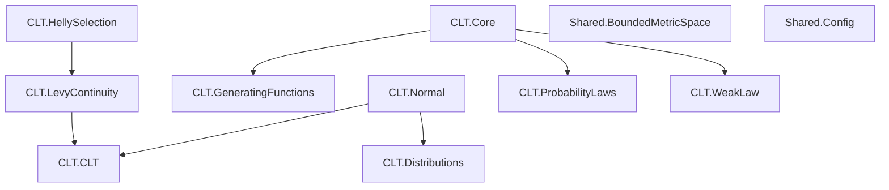
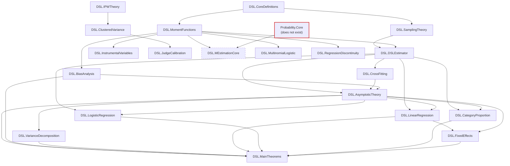

# FormalProbability: overview

This page covers four things: what `lake build` checks, the module import graph, how the
status counts in the [README](../README.md) were produced, and known issues. Everything
here was derived from the source files. Nothing was derived from a build.

## 1. What `lake build` checks

`lakefile.toml` declares a single `lean_lib` named `FormalProbability` with
`defaultTargets = ["FormalProbability"]`. With default settings, Lake builds the root module
`FormalProbability.lean` and everything it imports, transitively.

| | Modules | `theorem`/`lemma` | Lines |
|---|---:|---:|---:|
| Reachable from `FormalProbability.lean` (built) | 42 (incl. 5 entry-point files) | 221 | 10,936 |
| Not reachable, excluding `README.lean` | 14 | 125 | 5,544 |
| `README.lean` (documentation-only modules, not imported) | 10 | 0 | |

These 14 modules are not checked by `lake build`:

- `Econometrics/OLS/{GaussMarkov, RSquared, Inference, AsymptoticOLS}`
- `Econometrics/IV/{TwoSLS, Identification, WeakInstruments}`
- `Econometrics/Panel/{FixedEffects, RandomEffects, Hausman}`
- `Econometrics/Diagnostics/{OmittedVariableBias, Heteroskedasticity, FunctionalForm}`
- `DSL/MEstimationCore`. It imports `FormalProbability.Probability.Core`, which does not
  exist. The definitions it uses (`expectationVec`, `sampleMeanVec`, `IID`) live in
  `FormalProbability.CLT.Core`.

## 2. Import graph

These diagrams are generated from the `import` lines. An arrow `A --> B` means B imports A.
Dashed nodes are not built. Rounded nodes belong to another area. The entry-point files
(`FormalProbability.lean`, `CLT.lean`, `DSL.lean`, `Econometrics.lean`, `ML.lean`) are
omitted. They only import. Mathlib imports are not shown; every module depends on Mathlib,
directly or through another module.

The root module imports `Shared.Config`, `Shared.BoundedMetricSpace`, `CLT`,
`Econometrics`, `ML`, `DSL`, `DSL.IPWTheory`, `DSL.ClusteredVariance`, and
`DSL.JudgeCalibration`.

### CLT and Shared

The Shared modules have no local imports, and only the root module imports them.

### Econometrics and ML

```mermaid
flowchart TD
  classDef unbuilt stroke-dasharray: 5 5
  classDef missing stroke:#c00,stroke-width:2px
  Econometrics_Assumptions["Econometrics.Assumptions"]
  Econometrics_Core["Econometrics.Core"]
  Econometrics_Diagnostics_FunctionalForm["Econometrics.Diagnostics.FunctionalForm"]:::unbuilt
  Econometrics_Diagnostics_Heteroskedasticity["Econometrics.Diagnostics.Heteroskedasticity"]:::unbuilt
  Econometrics_Diagnostics_OmittedVariableBias["Econometrics.Diagnostics.OmittedVariableBias"]:::unbuilt
  Econometrics_IPWIdentification["Econometrics.IPWIdentification"]
  Econometrics_IV_Identification["Econometrics.IV.Identification"]:::unbuilt
  Econometrics_IV_TwoSLS["Econometrics.IV.TwoSLS"]:::unbuilt
  Econometrics_IV_WeakInstruments["Econometrics.IV.WeakInstruments"]:::unbuilt
  Econometrics_OLS_AsymptoticOLS["Econometrics.OLS.AsymptoticOLS"]:::unbuilt
  Econometrics_OLS_GaussMarkov["Econometrics.OLS.GaussMarkov"]:::unbuilt
  Econometrics_OLS_Inference["Econometrics.OLS.Inference"]:::unbuilt
  Econometrics_OLS_RSquared["Econometrics.OLS.RSquared"]:::unbuilt
  Econometrics_Panel_FixedEffects["Econometrics.Panel.FixedEffects"]:::unbuilt
  Econometrics_Panel_Hausman["Econometrics.Panel.Hausman"]:::unbuilt
  Econometrics_Panel_RandomEffects["Econometrics.Panel.RandomEffects"]:::unbuilt
  Econometrics_PropensityScore["Econometrics.PropensityScore"]
  ML_Core["ML.Core"]
  ML_DecisionTree["ML.DecisionTree"]
  ML_ERM["ML.ERM"]
  CLT_Core(["CLT.Core"])
  DSL_AsymptoticTheory(["DSL.AsymptoticTheory"])
  Econometrics_Core --> Econometrics_Assumptions
  CLT_Core --> Econometrics_Core
  Econometrics_OLS_GaussMarkov --> Econometrics_Diagnostics_FunctionalForm
  Econometrics_OLS_GaussMarkov --> Econometrics_Diagnostics_Heteroskedasticity
  Econometrics_OLS_AsymptoticOLS --> Econometrics_Diagnostics_Heteroskedasticity
  Econometrics_OLS_GaussMarkov --> Econometrics_Diagnostics_OmittedVariableBias
  Econometrics_Assumptions --> Econometrics_IPWIdentification
  Econometrics_PropensityScore --> Econometrics_IPWIdentification
  Econometrics_IV_TwoSLS --> Econometrics_IV_Identification
  Econometrics_OLS_GaussMarkov --> Econometrics_IV_TwoSLS
  Econometrics_OLS_AsymptoticOLS --> Econometrics_IV_TwoSLS
  Econometrics_IV_Identification --> Econometrics_IV_WeakInstruments
  CLT_Core --> Econometrics_OLS_AsymptoticOLS
  DSL_AsymptoticTheory --> Econometrics_OLS_AsymptoticOLS
  Econometrics_OLS_GaussMarkov --> Econometrics_OLS_AsymptoticOLS
  CLT_Core --> Econometrics_OLS_GaussMarkov
  Econometrics_OLS_GaussMarkov --> Econometrics_OLS_Inference
  Econometrics_OLS_AsymptoticOLS --> Econometrics_OLS_Inference
  Econometrics_OLS_GaussMarkov --> Econometrics_OLS_RSquared
  Econometrics_OLS_GaussMarkov --> Econometrics_Panel_FixedEffects
  Econometrics_Panel_RandomEffects --> Econometrics_Panel_Hausman
  Econometrics_Panel_FixedEffects --> Econometrics_Panel_RandomEffects
  Econometrics_Assumptions --> Econometrics_PropensityScore
  CLT_Core --> ML_Core
  ML_Core --> ML_DecisionTree
  ML_ERM --> ML_DecisionTree
  ML_Core --> ML_ERM
```

### DSL

## 3. How the status counts were produced

All counts come from static inspection of the `.lean` sources at commit `718126e`, plus
this documentation commit.

- **`sorry` / `admit` / `axiom`.** Whole-word search over every `.lean` file. `sorry` has
  one hit, inside the module doc comment of `FormalProbability.lean`.
  `admit` and `axiom` have no hits as tactics or declarations. (The word "axiom" occurs only
  in comments, and in theorem and structure names such as `hajek_unbiased_axiom` and
  `MEstimationAxioms`.)
- **Theorem count.** Lines that begin a `theorem` or `lemma` declaration, including
  `private` ones.
- **Placeholder.** A theorem counts as a placeholder if any of the following holds:
  - its conclusion is `True`, or a structure whose only field is `True`, and its proof is
    `trivial` or `⟨trivial⟩`;
  - its whole proof is `exact h` for a hypothesis `h` with the same statement;
  - it states `x = x`.
- **Conditional.** A theorem counts as conditional if its signature takes
  `MEstimationAxioms`, `CoverageAxioms`, or `OLSAsymptoticAxioms`, and its proof goes
  through a field of that bundle, either directly or through another conditional theorem.

These checks are syntactic. They do not catch statements that are true but much weaker than
their names suggest. For example, `surrogate_bound` and `surrogate_guarantee` in
`DSL/JudgeCalibration` prove only that a sum of absolute values and square roots is
non-negative. The README notes these cases by hand.

## 4. Placeholder theorems (78)

Built modules (4):

- `DSL/SamplingTheory`: `expectation_R_eq_π` (states `x = x`)
- `DSL/BiasAnalysis`: `llm_errors_not_classical` (the conclusion is a hypothesis)
- `DSL/IPWTheory`: `hajek_unbiased_axiom`, `hajek_variance_bound` (conclusion `True`)

Not-built modules (74):

- `Econometrics/OLS/RSquared` (1): `rsquared_no_intercept_warning`
- `Econometrics/OLS/Inference` (7): `t_stat_distribution`, `ci_exact_coverage`,
  `f_stat_equivalence`, `f_stat_distribution`, `overall_f_from_rsquared`,
  `wald_lm_lr_asymptotic_equivalence`, `test_stat_ordering`
- `Econometrics/OLS/AsymptoticOLS` (2): `sample_Q_converges`, `hc_variance_consistent`
- `Econometrics/Diagnostics/OmittedVariableBias` (4): `omitted_variable_bias`,
  `omitted_variable_bias_expectation`, `proxy_reduces_bias`, `bias_bound`
- `Econometrics/Diagnostics/Heteroskedasticity` (8): `ols_consistent_under_heteroskedasticity`,
  `usual_variance_wrong`, `bp_distribution_under_null`, `hc_consistent`, `hc_t_stat_valid`,
  `wls_is_blue`, `fgls_asymptotically_efficient`, `log_residuals_regression`
- `Econometrics/Diagnostics/FunctionalForm` (6): `log_level_approx`, `quadratic_concave`,
  `quadratic_convex`, `optimal_at_turning_point`, `cross_partial_equals_interaction`,
  `nonlinear_ame_ne_mem`
- `Econometrics/IV/TwoSLS` (8): `projection_idempotent`, `projection_symmetric`,
  `twosls_consistent`, `ols_inconsistent_when_endogenous`, `twosls_less_efficient_than_ols`,
  `twosls_decomposition`, `twosls_as_gmm`, `efficient_gmm_equals_twosls_under_homosked`
- `Econometrics/IV/Identification` (9): `rank_condition_iff_identified`,
  `no_identification_without_rank`, `just_identified_formula`, `just_identified_equivalence`,
  `no_overid_test_when_just_id`, `sargan_distribution`, `sargan_rejection_interpretation`,
  `multiple_endogenous_order`, `multiple_endogenous_rank`
- `Econometrics/IV/WeakInstruments` (8): `twosls_bias_weak_instruments`,
  `weak_iv_test_oversized`, `weak_iv_poor_coverage`, `liml_approximately_unbiased`,
  `liml_infinite_variance`, `ar_may_be_unbounded`, `clr_valid_weak_iv`,
  `clr_more_powerful_than_ar`
- `Econometrics/Panel/FixedEffects` (5): `within_transformation`, `fe_consistent`,
  `time_invariant_demeaned_zero`, `first_diff_eliminates_fe`, `pooled_ols_biased_with_fe`
- `Econometrics/Panel/RandomEffects` (9): `composite_error_covariance`,
  `theta_zero_when_no_heterogeneity`, `theta_approaches_one_as_heterogeneity_grows`,
  `re_consistent`, `re_more_efficient_than_fe`, `re_inconsistent_when_correlated`,
  `re_estimates_time_invariant`, `between_consistent_under_re`, `re_is_weighted_average`
- `Econometrics/Panel/Hausman` (7): `cov_fe_with_difference_zero`, `variance_of_difference`,
  `hausman_chi_squared`, `variance_difference_pd_issue`, `hausman_interpretation`,
  `hausman_power_issues`, `mundlak_hausman_equivalent`

## 5. Assumption bundles and placeholder structures

**Conditional theorems (30).**

- `DSL/AsymptoticTheory` (5): `DSL_consistent`, `DSL_consistent_crossfit`,
  `DSL_asymptotic_normal`, `DSL_asymptotic_normal_crossfit`, `DSL_valid_coverage`
- `DSL/LinearRegression` (2): `DSL_linear_unbiased`, `DSL_linear_valid_coverage`
- `DSL/LogisticRegression` (2): `DSL_logistic_consistent`, `DSL_odds_ratio_valid_coverage`
- `DSL/CategoryProportion` (2): `DSL_proportion_unbiased`, `DSL_proportion_valid_coverage`
- `DSL/FixedEffects` (2): `DSL_FE_consistent`, `DSL_FE_clustered_valid`
- `DSL/MainTheorems` (8): `DSL_valid_inference`, `DSL_valid_inference_oracle`,
  `DSL_CI_coverage`, `DSL_CI_coverage_oracle`, `DSL_dominates_naive`,
  `DSL_dominates_naive_oracle`, `DSL_guidelines`, `formal_results_summary`
- `Econometrics/OLS/AsymptoticOLS` (9, not built). All of its theorems except
  `sample_Q_converges`, `hc_variance_consistent`, and `populationXε_eq_zero_of_weak_exog`.

**The bundles.**

- `MEstimationAxioms`, in `DSL/AsymptoticTheory`. Its fields `consistent` and
  `asymptotic_normal` assert, respectively, that any sample-moment solution converges to β*
  and that any sequence converges in distribution. The second quantifies over arbitrary
  sequences, so for parameter dimension d ≥ 1 it cannot hold together with an unbiasedness
  hypothesis.
- `CoverageAxioms`, in `DSL/AsymptoticTheory`. It asserts that any confidence-interval
  sequence has asymptotic coverage 1 − α once some sequence is asymptotically normal.
- `OLSAsymptoticAxioms`, in `Econometrics/OLS/AsymptoticOLS`. Its premise "β̂ is the OLS
  estimator" is `True`.

**Structures whose fields are only `True`.**

- `DSL/AsymptoticTheory`: `RegularityConditions` (5 fields), `CrossFittingConditions`,
  `NormalLimit`
- `Econometrics/OLS/Inference`: `TDistribution`, `FDistribution`, `ChiSquared`
- `Econometrics/Panel/Hausman`: `ChiSquared`

**Single `True` fields inside otherwise real structures.**

- `LinearHypothesis.h_rank` (OLS/Inference)
- `Identified.Q_pd` (OLS/AsymptoticOLS)
- `NormalErrors.normal_distribution` (OLS/GaussMarkov)
- `InstrumentRelevance.relevant` (IV/TwoSLS)
- `RankCondition.full_rank` (IV/Identification)
- `FERankCondition.full_rank` (Panel/FixedEffects)

Several theorems also take hypotheses of type `True` labelled "semantic", for example
`h_propensities_correct` in `DSL/JudgeCalibration` and `h_independent` in
`DSL/ClusteredVariance`. These hypotheses carry no information.

## 6. Known issues outside the proofs

- **Committed build artifacts.** `.lake/` was committed before `.gitignore` was added.
  - The tracked files include `.lake/build/ir/FormalProbability/Shared/Config.c`, Lean's
    generated C for `Shared/Config.lean`. It is not a source file, and there is no other C
    in the repository.
  - Also tracked: `.olean`/`.ilean`/trace files for `Shared/Config` and a large
    `IPWTheory.setup.json`.
  - Eight `.lake/packages/*` gitlinks (mode 160000) point at the dependency commits, with no
    `.gitmodules`.
- **Shared/Config is file-local.** The `set_option`s in `Shared/Config.lean` apply only to
  that file. Each module sets its own options. Project-wide options come from
  `[leanOptions]` in `lakefile.toml`.
- **BoundedMetricSpace is unused.** `Shared/BoundedMetricSpace` is not used by any other
  module. Its header refers to removing a `PMF.summable_coe_real_mul` axiom from a project
  that is not in this repository.
- **Missing notes.** `DSL/ClusteredVariance` and `DSL/JudgeCalibration` cite
  `RLHF_DSL_BANDIT_NOTES.md`, which is not included.
- **Misnamed PDF.** `CLT/lean_clt.pdf` is a copy of Avigad, Hölzl & Serafin,
  arXiv:1405.7012v4 (the Isabelle CLT paper), not a write-up of this project.
- **Cross-area import.** `Econometrics/OLS/AsymptoticOLS` imports `DSL/AsymptoticTheory`
  to reuse `ConvergesInDistributionToNormal` and `CoverageAxioms`. As a result, the OLS
  submodule depends on the DSL module.
