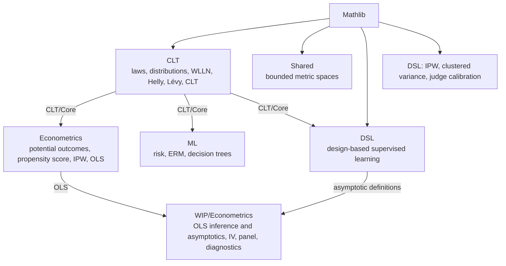

# How the project fits together

The library is a single Lake package, `FormalProbability`. Its default target is the root
module `FormalProbability.lean`, which imports one entry-point module per area
(`CLT.lean`, `Econometrics.lean`, `DSL.lean`, `ML.lean`) plus `Shared/BoundedMetricSpace`.
Everything reachable from the root is checked by `lake build` and by CI. Modules under
`FormalProbability/WIP/` are drafts and are not imported by the root.

## Area dependencies

An arrow `A --> B` means that B imports A. Every area also depends on Mathlib.

`CLT/Core` (expectation, i.i.d. sequences, sample means, modes of convergence) is the
shared probability vocabulary that the other areas import.

## Within each area

- **CLT.** Two strands lead to the main theorem: `Normal` (the standard normal and its
  characteristic function) and `HellySelection` → `LevyContinuity` (weak convergence from
  convergence of characteristic functions). `CLT` combines them. `ProbabilityLaws`,
  `GeneratingFunctions`, and `WeakLaw` build on `Core`, and `Distributions` on `Normal`.
- **Econometrics.** `Core` (treatment, potential outcomes, the average treatment effect)
  → `Assumptions` (consistency, unconfoundedness, positivity) → `PropensityScore` →
  `IPWIdentification`. Separately, `OLS/GaussMarkov` (unbiasedness, variance, Gauss-Markov)
  → `OLS/RSquared` (sum-of-squares decomposition and goodness of fit).
- **DSL.** `CoreDefinitions` → `SamplingTheory` and `MomentFunctions` → `DSLEstimator`
  (the design-adjusted outcome and moments) → `CrossFitting`. `BiasAnalysis` works from
  the moment functions alone. `AsymptoticTheory` brings these together; the variance
  analysis and the regression files (linear, logistic, category proportions, fixed
  effects) build on it, and `MainTheorems` collects the headline statements. The
  multinomial-logit, instrumental-variable, and regression-discontinuity files define the
  corresponding moment functions. `MEstimationCore` connects moment functions to the
  expectation and i.i.d. definitions in `CLT/Core`. A second chain, `IPWTheory` →
  `ClusteredVariance` → `JudgeCalibration`, covers Horvitz-Thompson and Hájek estimation
  with logged propensities, document-clustered variance, and judge-versus-oracle
  calibration.
- **ML.** `Core` → `ERM` → `DecisionTree`.
- **WIP.** The econometrics drafts build on `Econometrics/OLS/GaussMarkov`; the asymptotic
  OLS draft also reuses definitions from `DSL/AsymptoticTheory`.

## Known gaps

- The DSL asymptotic results are stated relative to assumption structures; they are not
  yet derived from the CLT and weak-law results in `CLT/`.
- The econometrics drafts under `WIP/` still contain placeholder statements and are kept
  out of the default build until they are filled in.
